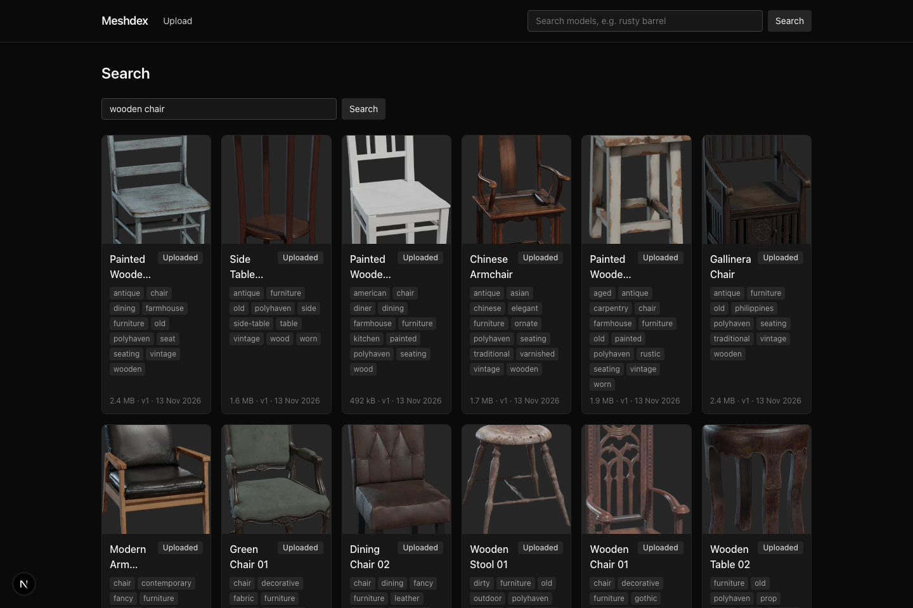
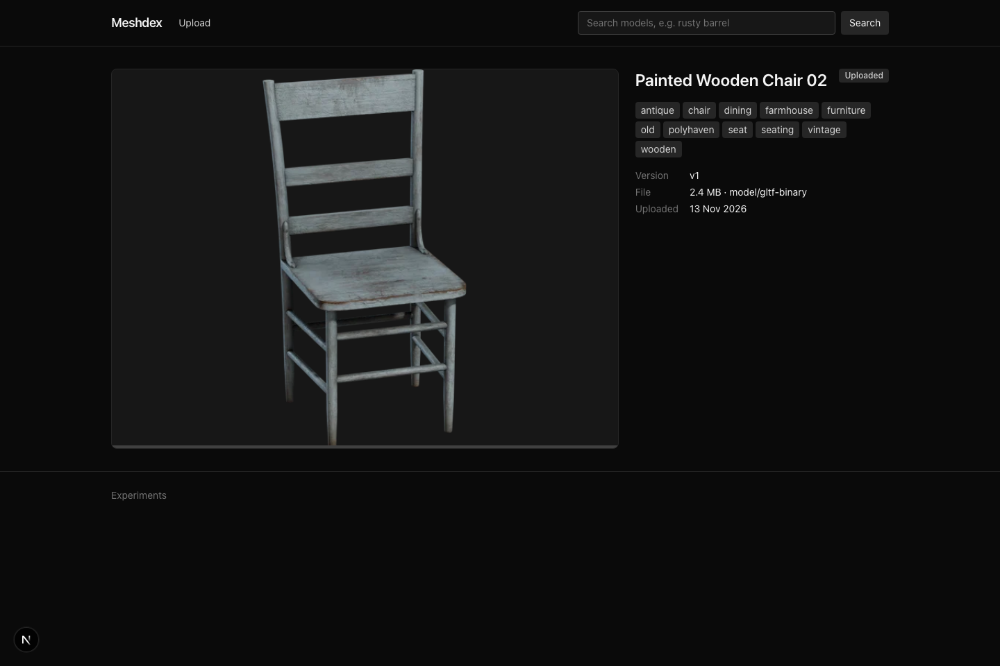
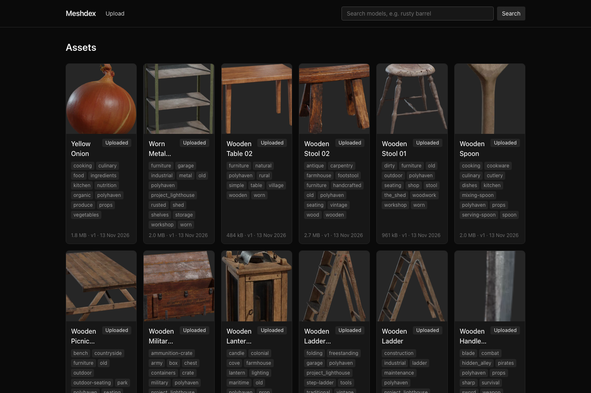
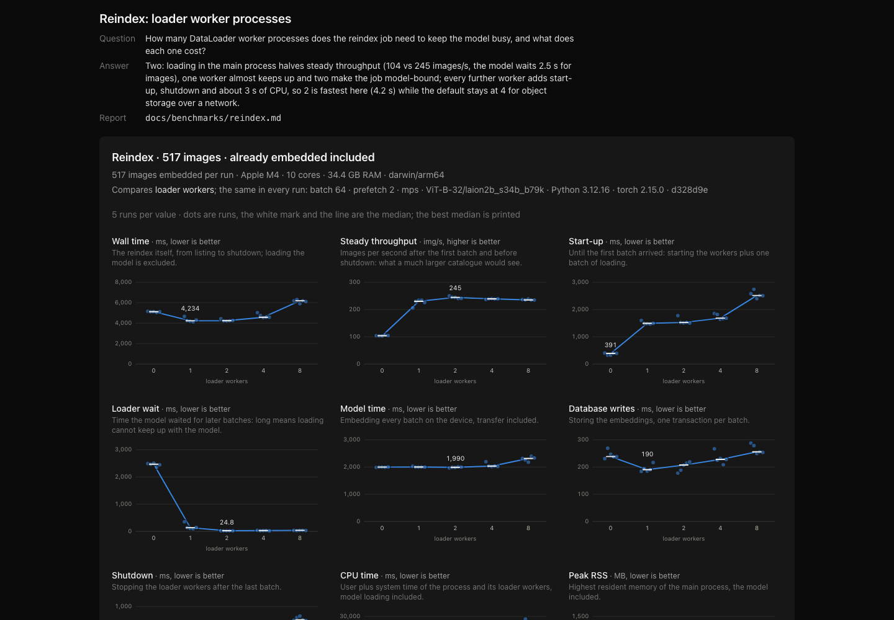

# Meshdex

A 3D asset library with natural-language search. Upload glTF/GLB models, browse them, preview them in 3D in the browser, and find them by describing them ("wooden chair", "street lamp"): CLIP embeds the models' preview images, and pgvector finds the nearest ones to the embedded query.

It is built as a set of microservices (Next.js, NestJS GraphQL gateway, NestJS and Python gRPC services, PostgreSQL + pgvector, S3), with an emphasis on efficient data loading, measured performance and decisions that are written down: every non-obvious choice is an [ADR](docs/adr/README.md), and every performance claim links to recorded benchmark runs.

**Status:** upload, browsing, 3D preview, text search, bulk import and the benchmark pipeline work end to end, locally. The processing worker (Kafka), Kubernetes and the AWS deployment are designed but not built yet: see [What is not built yet](#what-is-not-built-yet).

| Search                                                            | Asset page                                                 |
| ----------------------------------------------------------------- | ---------------------------------------------------------- |
|  |     |
| **Library**                                                       | **Experiments**                                            |
|                             |  |

## What works

- **Upload from the browser**: presigned multipart upload straight to object storage, parts in parallel with progress, retries with backoff, re-signing of expired URLs and resume after a closed tab.
- **Library and asset page**: paginated grid (keyset pagination) and an in-browser 3D viewer (React Three Fiber) that cross-fades from the still image into the model.
- **Text search**: the query is embedded by CLIP (ViT-B/32, LAION-2B weights) in `ml-service`, matched against image embeddings with an HNSW index in pgvector, and the gateway returns the ranked assets in one batched call to `asset-service`.
- **Bulk import** (`ingest` CLI): CC0 models from Poly Haven, fetched resumably into a local cache, packed glTF → GLB and uploaded through the same flow as the browser, as a two-stage pipeline with backpressure.
- **Reindex job** (`ml-service`): embeds the catalogue with a PyTorch DataLoader pipeline (worker processes fetch, decode and resize; the main process runs the model and writes batches with binary `COPY`).
- **Experiments page**: every benchmark run is recorded as JSON with the machine and git commit, and the web app compares runs of one experiment in server-rendered charts.

## Architecture

What runs today:

```
Browser ── HTTPS ──► web (Next.js) ── GraphQL ──► gateway (NestJS, GraphQL code-first)
   │                                                 │ gRPC                │ gRPC
   │ presigned PUT/GET                               ▼                     ▼
   │                                   asset-service (NestJS)      ml-service (Python)
   │                                   PostgreSQL: assets,         CLIP + PostgreSQL/pgvector:
   │                                   versions, tags, outbox      embeddings, HNSW search
   ▼                                          │                         ▲
 S3 (SeaweedFS locally) ◄─────────────────────┘                         │
   ▲   originals (private), previews (public)                          │ gRPC ListAssets
   │                                                                    │ + S3 previews
 ingest CLI ── gRPC ──► asset-service           ml-service reindex job ─┘
```

- **Database per service**: `asset-service` and `ml-service` each own their database and talk only over gRPC; `packages/proto` is the only shared contract (buf lint; breaking-change rules are configured for CI).
- **File bytes never pass through the services**: clients upload to presigned URLs, services only sign URLs and record what is stored.
- **Transactional outbox**: completing an upload writes the status change and the `asset.uploaded` event in one transaction, ready for the relay to Kafka (not built yet).

The target architecture, with the processing worker, Kafka and the deployment, is in [docs/architecture.md](docs/architecture.md).

## Engineering highlights

Each line links to where it is explained and measured.

- **Finding the bottleneck of the reindex pipeline by measurement.** The job records how long the model waits for images. Loading in the main process: 104 images/s with 2.5 s of waiting. With two loader workers: 245 images/s, 94 % of what the model alone can do, so the job is model-bound and more workers only add start-up and about 450 MB each. Larger batches help because fewer, bigger database writes sit on the model's path, which names the next optimisation. [Report](docs/benchmarks/reindex.md)
- **Backpressure in the import pipeline.** P packers → bounded queue of Q → U uploaders, so at most P + Q + U models are in memory whichever stage is slower. Measured: 1 → 8 parallel uploads take the import from 40 to 88 MB/s with diminishing returns, and moving packing to worker threads doesn't help because the import is upload-bound. [Upload concurrency](docs/benchmarks/ingest-upload-concurrency.md), [worker threads](docs/benchmarks/ingest-import.md)
- **PostgreSQL details that showed up in measurements.** A 512-d vector is just above the TOAST threshold; keeping it inside the row cut search p50 from 5.8 to 2.1 ms. Embeddings are written per batch with binary `COPY` behind a conditional upsert that keeps an older version from overwriting a newer one. [Data processing](docs/data-processing.md)
- **No N+1 across services.** A per-request DataLoader in the gateway turns every asset a GraphQL query touches into one `BatchGetAssets` call; search results are fetched the same way, in ranking order.
- **gRPC calls with deadlines and safe retries.** Deadlines and retry policies live in each channel's service config, so no call can forget them. Only `UNAVAILABLE` is retried; `InitiateUpload`, which creates an asset, never is. [Conventions](docs/conventions.md)
- **Model serving that behaves under load.** `ml-service` warms the model up before it reports ready (the first call costs 1.2 s instead of 15 ms), runs one model call at a time, refuses work beyond a concurrency limit with `RESOURCE_EXHAUSTED` instead of queueing without bound, and separates liveness from readiness for graceful shutdown. [ADR 019](docs/adr/019-ml-service-grpc-server.md)
- **Reproducible benchmarks.** Runs are JSON files with the options, machine, git commit and dirty flag; configurations run in interleaved, rotated rounds after a warm-up, so slow drift doesn't favour one of them; reports state their method and limitations. [Benchmarks](docs/benchmarks/README.md), [ADR 014](docs/adr/014-benchmark-runs-as-json-in-the-repo.md)

## Tech stack

| Area      | Choice                                                                                                                            |
| --------- | --------------------------------------------------------------------------------------------------------------------------------- |
| Web       | Next.js (App Router), React, React Three Fiber, TanStack Query, Tailwind, zod                                                     |
| API       | NestJS, GraphQL code-first (Apollo), DataLoader                                                                                   |
| Services  | NestJS + Drizzle (`asset-service`), Python 3.12 + grpcio + open_clip + PyTorch + psycopg 3 (`ml-service`)                         |
| Contracts | Protocol Buffers with buf, ts-proto                                                                                               |
| Data      | PostgreSQL 18 + pgvector (HNSW), S3 (SeaweedFS locally), Redpanda (Kafka API)                                                     |
| Tooling   | pnpm workspaces + Turborepo, TypeScript strict, ESLint, Prettier, Jest, Vitest, uv, ruff, mypy `--strict`, pytest, Testcontainers |

## Repository layout

```
apps/
  web/             Next.js app: library, asset page, upload, search, experiments
  gateway/         GraphQL API in front of the gRPC services
  asset-service/   assets, versions, tags, uploads, outbox (gRPC)
  ml-service/      CLIP embeddings, search server and reindex job (Python, gRPC)
  ingest/          CLI: fetch and import CC0 models, recorded benchmark runs
packages/
  proto/           .proto contracts, buf config, generated TypeScript
  shared/          infrastructure shared by the Node services (logging, config validation, time)
infra/docker/      local infrastructure (Postgres + pgvector, Redpanda, SeaweedFS)
docs/              architecture, conventions, ADRs, roadmap, data processing, benchmarks
```

## Running locally

Needs Node.js 24, pnpm, Python 3.12 with uv, and Docker.

```bash
pnpm install
(cd apps/ml-service && uv sync)

# Infrastructure: Postgres + pgvector, Redpanda, SeaweedFS (S3)
cp infra/docker/.env.example infra/docker/.env
docker compose -f infra/docker/compose.yml up -d

# Per-service configuration (defaults match the local infrastructure)
for app in asset-service gateway ingest ml-service web; do cp apps/$app/.env.example apps/$app/.env; done

# Database migrations
pnpm --filter @meshdex/asset-service db:migrate
pnpm --filter @meshdex/ml-service db:migrate
```

The CLIP weights are never downloaded at runtime ([ADR 018](docs/adr/018-ml-service-tooling-data-access-and-reindex-job.md)). Download `open_clip_model.safetensors` from the Hugging Face repository `laion/CLIP-ViT-B-32-laion2B-s34B-b79K` and save it as `apps/ml-service/.cache/models/open_clip_ViT-B-32_laion2b_s34b_b79k.safetensors` (about 600 MB). On Apple silicon set `CLIP_DEVICE=mps` in `apps/ml-service/.env`.

```bash
pnpm dev    # web on http://localhost:3000, gateway on :4000, asset-service and ml-service over gRPC
```

Import some models and make them searchable (with `pnpm dev` running):

```bash
pnpm --filter @meshdex/ingest build
pnpm --filter @meshdex/ingest start fetch --limit 50     # Poly Haven → apps/ingest/.cache
pnpm --filter @meshdex/ingest start import --limit 50    # cache → GLB → asset-service
cd apps/ml-service && uv run python -m ml_service reindex
```

Checks: `pnpm lint`, `pnpm typecheck`, `pnpm test` (all services, including ml-service).

## What is not built yet

Planned in the [roadmap](docs/roadmap.md), with the decisions that are already made recorded as ADRs:

- **Processing pipeline**: the outbox relay to Kafka and the processing worker (idempotent consumer, model optimisation with glTF-Transform, rendered thumbnails, retries and a dead-letter topic). Until then previews are the images supplied with the upload, and the reindex job embeds them.
- **Kubernetes**: Dockerfiles, Helm charts and a kind cluster, with the worker scaled by consumer lag (KEDA).
- **AWS**: Terraform for S3, CloudFront and k3s on EC2 ([ADR 001](docs/adr/001-k3s-on-ec2-instead-of-eks.md)), observability with OpenTelemetry, CI, a public demo.
- **Search quality evaluation**: a labelled query set with recall@k, comparing CLIP models and HNSW vs IVFFlat on recall and latency.
- **Auth**, live processing status, integration tests for `asset-service` with Testcontainers, and a reconciler for abandoned uploads.

## Documentation

- [Architecture](docs/architecture.md): services, data ownership, event flow, target deployment
- [Decisions (ADRs)](docs/adr/README.md): 20 decisions with the alternatives considered
- [Data processing](docs/data-processing.md): data loading and processing techniques, why, and their measurements
- [Benchmarks](docs/benchmarks/README.md): reports and the raw runs behind them
- [Conventions](docs/conventions.md) and [roadmap](docs/roadmap.md)

## Assets

Imported models are CC0, from [Poly Haven](https://polyhaven.com/), and are tagged `polyhaven`.
